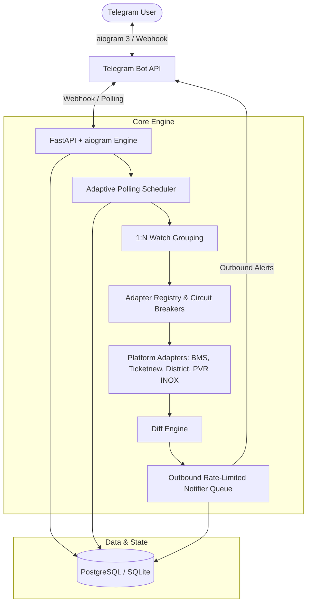

# 🎬 TicketNotify — Real-Time Cinema Ticket Opening Alert Bot

A production-grade, real-time Telegram bot and asynchronous backend that monitors movie ticket booking platforms worldwide and sends instant notifications the moment bookings open, new shows or seats are added, or ticket prices drop.

---

## 🌟 Key Features

- **Multi-Platform Monitoring (Isolated Adapters)**:
  - **BookMyShow (BMS)**
  - **Ticketnew**
  - **District (by Zomato)**
  - **PVR INOX**
  - Modular architecture allowing any cinema platform worldwide (*Fandango, AMC, Cineworld, Vox Cinemas, Cinepolis*) to be added via a single adapter file.
- **Separate Per-Platform Notifications**:
  - Each platform sends its own alert with platform badge and direct deep link to the booking page.
- **Worldwide Location Handling**:
  - Supports city names, pincodes/postal codes, area names, and direct Telegram GPS location sharing.
  - Geocoding and normalization via OpenStreetMap Nominatim with caching and fallback databases.
  - Automatically maps locations to platform-specific region codes and identifies unsupported platforms for the user's country.
- **Real-Time Diff Engine**:
  - Detects 5 change types: `bookings_opened`, `new_show_added`, `seats_filling_fast`, `price_drop`, and `specific_cinema_opened`.
  - State snapshot hashes stored in DB/Redis; diffs old vs. new snapshots to guarantee **zero spam**.
- **1:N Request Deduplication**:
  - Adaptive scheduler groups identical `(movie, city, platform)` watches into a **single HTTP request**, regardless of how many users track it.
- **Resilient Scraper Architecture**:
  - Rotating User-Agents, jittered delays, and HTTP/SOCKS5 proxy support.
  - Per-platform **Circuit Breakers** (`CLOSED` -> `OPEN` -> `HALF_OPEN`) so one failing platform never blocks others.
  - Automatic **Scraper Broken Alert** sent to the Telegram Admin when a platform endpoint fails or changes structure.
- **Telegram Outbound Rate Limiter**:
  - Strict queue enforcing Telegram limits: max 30 msg/s global and max 1 msg/s per chat with exponential backoff on 429.
  - User-configurable **Quiet Hours** (e.g. 23:00 to 07:00).
- **Production-Ready Ops & Observability**:
  - FastAPI webhook receiver with secret token validation + fallback long-polling for local dev.
  - Prometheus `/metrics` endpoint (polling latency, active watches, notification counters, circuit states).
  - Health check endpoint `/health` and admin status `/api/admin/status`.
  - GDPR-compliant `/deleteme` command to permanently wipe user data.

---

## 🏗 System Architecture



---

## 📁 Project Structure

```text
TicketNotify/
├── ticketnotify/
│   ├── __init__.py
│   ├── config.py                  # Pydantic configuration & env parsing
│   ├── main.py                    # Server runner
│   ├── database/
│   │   ├── __init__.py
│   │   ├── models.py              # SQLAlchemy 2.0 models (User, Location, Alert, State, Log)
│   │   ├── session.py             # Async engine & session factory
│   │   └── crud.py                # CRUD queries for alerts, users, states
│   ├── location/
│   │   ├── __init__.py
│   │   ├── models.py              # NormalizedLocation dataclass
│   │   ├── geocoder.py            # OSM Nominatim geocoding & reverse geocoding
│   │   ├── matcher.py             # Platform city & region code matcher
│   │   └── distance.py            # Haversine distance & radius filter
│   ├── adapters/
│   │   ├── __init__.py
│   │   ├── base.py                # Abstract Base Class, MovieMatch, Show models
│   │   ├── circuit_breaker.py     # PlatformCircuitBreaker & alert triggers
│   │   ├── http_client.py         # Resilient HTTP client (UA rotation, jitter, proxies)
│   │   ├── registry.py            # Central registry & platform dispatch
│   │   ├── bms.py                 # BookMyShow adapter
│   │   ├── ticketnew.py           # Ticketnew adapter
│   │   ├── district.py            # District (Zomato) adapter
│   │   ├── pvrinox.py             # PVR INOX adapter
│   │   └── template.py            # Template for adding new platforms
│   ├── engine/
│   │   ├── __init__.py
│   │   ├── diff_engine.py         # Diff logic (opened, new show, seats fast, price drop)
│   │   ├── notifier.py            # Outbound rate limiter & message formatter
│   │   └── scheduler.py           # Adaptive grouped polling engine
│   ├── bot/
│   │   ├── __init__.py
│   │   ├── bot.py                 # Bot instance & router configuration
│   │   ├── states.py              # FSM dialog states
│   │   ├── keyboards.py           # Inline & Reply keyboards
│   │   └── handlers/
│   │       ├── start.py           # /start onboarding & language selector
│   │       ├── track.py           # /track interactive guided wizard
│   │       ├── alerts.py          # /list, /remove, pause/resume/mute/delete
│   │       ├── location.py        # /location management
│   │       ├── settings.py        # /settings & quiet hours
│   │       ├── help.py            # /help documentation
│   │       ├── gdpr.py            # /deleteme privacy wipe
│   │       └── admin.py           # /stats, /broadcast, /platform_status
│   └── api/
│       ├── __init__.py
│       └── app.py                 # FastAPI webhook, /health, /metrics
├── tests/
│   ├── fixtures/                  # Recorded JSON fixtures for all platforms
│   │   ├── bms_quicksearch.json
│   │   ├── bms_showtimes.json
│   │   ├── ticketnew_shows.json
│   │   ├── district_shows.json
│   │   └── pvrinox_shows.json
│   ├── test_adapters.py           # Adapter parser tests
│   ├── test_diff_engine.py        # Diff engine tests
│   ├── test_location_and_circuit.py # Geocoding & circuit breaker tests
│   └── test_scheduler_grouping.py # 1:N deduplication tests
├── Dockerfile                     # Multi-stage production container
├── docker-compose.yml             # Full stack (Postgres + Redis + App)
├── requirements.txt               # Pinned dependencies
├── run.py                         # Single-file runner
├── .env.example                   # Environment configuration template
└── README.md
```

---

## 🚀 Getting Started

### 1. Prerequisites
- Python 3.11+
- (Optional for Docker) Docker & Docker Compose

### 2. Local Installation
```bash
git clone <repo_url>
cd TicketNotify

# Create virtual environment
python -m venv venv
source venv/bin/activate  # On Windows: venv\Scripts\activate

# Install dependencies
pip install -r requirements.txt
```

### 3. Configure Environment Variables
Copy `.env.example` to `.env`:
```bash
cp .env.example .env
```

Key variables in `.env`:
| Variable | Description | Default / Example |
|---|---|---|
| `BOT_TOKEN` | Telegram Bot token from @BotFather | `9094648730:AAGav3...` |
| `ADMIN_ID` | Telegram ID of the administrator | `1483331491` |
| `DATABASE_URL` | SQLAlchemy Async DB URL | `sqlite+aiosqlite:///./ticketnotify.db` or PostgreSQL |
| `REDIS_URL` | Redis URL for caching | `redis://localhost:6379/0` |
| `WEBHOOK_MODE` | `true` in prod (HTTPS), `false` for local polling | `false` |
| `WEBHOOK_URL` | Public HTTPS URL (e.g. Railway / Render / domain) | `https://your-bot-domain.com` |
| `HOT_POLL_INTERVAL` | Interval (seconds) for imminent/hot alerts | `20` |
| `IDLE_POLL_INTERVAL` | Interval (seconds) for normal movies | `150` |
| `PROXY_LIST` | Comma-separated HTTP/SOCKS proxies | `` |

### 4. Running the Bot
```bash
python run.py
```
Output:
```text
INFO: Application startup complete.
INFO: Database schema initialized successfully.
INFO: Telegram outbound notification worker started.
INFO: Adaptive polling scheduler started.
INFO: Starting aiogram long-polling background worker (local/dev mode)...
```

---

## 🐳 Docker Deployment

Run the complete production stack (PostgreSQL 16 + Redis 7 + TicketNotify App) in one command:

```bash
docker-compose up -d --build
```

Check health:
```bash
curl http://localhost:8000/health
```

---

## 🤖 Telegram Bot User Guide

### Commands
- `/start` — Onboarding welcome message and language picker (English, Tamil, Hindi, Telugu).
- `/track` — Guided 4-step wizard:
  1. **Movie Title**: Enter title (e.g. `Avatar: Fire and Ash`, `Kalki 2898 AD`).
  2. **Location**: Text city/pincode or tap 📍 Share GPS Location.
  3. **Platforms**: Checkbox selection of supported platforms in that country.
  4. **Filters**: Formats (`IMAX`, `3D`, `4DX`, `2D`), Max Ticket Price, Min Seats.
- `/list` — Display all your active alerts with **Pause**, **Resume**, and **Delete** inline buttons.
- `/remove <id>` — Delete a specific alert.
- `/location` — View and change default location.
- `/settings` — Configure **Quiet Hours** (e.g., `23 7` for 11 PM to 7 AM) and language.
- `/help` — Full guide and explanation of alert types.
- `/deleteme` — GDPR compliant erasure of all your personal data and active alerts.

### Admin Commands (Admin ID: 1483331491)
- `/stats` — Real-time metrics: registered users, active alerts, unique watch targets, polls executed, average latency.
- `/platform_status` — Live status of each platform adapter, API health, and circuit breaker state.
- `/broadcast` — Send an announcement message to all active users.

---

## 🔔 Notification Format Example

Each platform delivers a dedicated, distinct message with direct deep link:

```text
🚨 BOOKINGS OPENED

🎬 Avatar: Fire and Ash (English, IMAX 3D)
📍 PVR IMAX: Forum Mall, Koramangala
🕒 2026-12-18 | 10:30 AM
💺 🟡 Filling Fast (42 seats left) | ₹450 - ₹850
🏷 Platform: BookMyShow

[🎟 Book Now] (Direct Deep Link URL)
[🔕 Mute Alert]   [🛑 Stop Tracking]
```

---

## 🔌 Adding a New Platform Adapter

Adding a new platform (e.g. **Fandango**, **AMC**, **Cineworld**, **Vox Cinemas**) takes just 3 steps:

1. **Create the adapter file**: `ticketnotify/adapters/fandango.py`:
```python
from typing import List, Optional
from ticketnotify.adapters.base import PlatformAdapter, MovieMatch, Show, SeatStatus
from ticketnotify.location.models import NormalizedLocation

class FandangoAdapter(PlatformAdapter):
    platform_name = "fandango"
    platform_label = "Fandango"
    supported_countries = ["us"]

    async def search_movie(self, title: str, location: NormalizedLocation) -> List[MovieMatch]:
        # Implement search API call
        ...

    async def get_shows(self, movie_id: str, location: NormalizedLocation, target_date: Optional[str] = None) -> List[Show]:
        # Implement showtimes API call & return list of Show
        ...

    async def health_check(self) -> bool:
        return True
```

2. **Register it in `ticketnotify/adapters/registry.py`**:
```python
from ticketnotify.adapters.fandango import FandangoAdapter
registry.register(FandangoAdapter())
```

3. **Map country support in `ticketnotify/location/matcher.py`**:
```python
PLATFORM_OPERATING_COUNTRIES["fandango"] = ["us"]
```

---

## 📊 Observability & Metrics

- **Health Endpoint**: `GET /health`
  ```json
  {
    "status": "healthy",
    "database": "connected",
    "scheduler_running": true,
    "platforms": {
      "bms": true,
      "ticketnew": true,
      "district": true,
      "pvrinox": true
    },
    "circuit_breakers": [
      {"platform": "bms", "state": "closed", "failure_count": 0}
    ]
  }
  ```
- **Prometheus Metrics**: `GET /metrics`
  - `ticketnotify_active_users`
  - `ticketnotify_active_alerts`
  - `ticketnotify_unique_watches`
  - `ticketnotify_notifications_sent`
  - `ticketnotify_poll_latency_ms`
  - `ticketnotify_circuit_state{platform="..."}`
- **Admin Status JSON**: `GET /api/admin/status`

---

## 🧪 Running Tests

Run the full pytest suite with recorded fixtures:
```bash
python -m pytest -v
```

Tests include:
- `test_adapters.py`: Parses recorded JSON payloads from BookMyShow, Ticketnew, District, and PVR INOX.
- `test_diff_engine.py`: Tests `bookings_opened`, `new_show_added`, `seats_filling_fast`, and `price_drop`.
- `test_location_and_circuit.py`: Tests Haversine distance, country mapping, and circuit breaker trip/recovery.
- `test_scheduler_grouping.py`: Tests 1:N watch request collapsing.

---

## 🚢 Cloud Deployment Guides

### Deploy to Railway
1. Create a new project on [Railway.app](https://railway.app).
2. Provision a **PostgreSQL** and **Redis** service from the Railway dashboard.
3. Add a service from GitHub repo.
4. Set environment variables in Railway:
   - `BOT_TOKEN`: `9094648730:AAGav3...`
   - `ADMIN_ID`: `1483331491`
   - `DATABASE_URL`: `${{Postgres.DATABASE_URL}}`
   - `REDIS_URL`: `${{Redis.REDIS_URL}}`
   - `WEBHOOK_MODE`: `true`
   - `WEBHOOK_URL`: `https://${{RAILWAY_STATIC_URL}}`
5. Railway deploys the Dockerfile automatically and sets up the webhook!

### Deploy to Render
1. Create a **Web Service** on [Render.com](https://render.com).
2. Choose **Docker** runtime.
3. Add a free Render PostgreSQL and Redis instance.
4. Set `WEBHOOK_MODE=true` and `WEBHOOK_URL=https://your-service.onrender.com`.

### Deploy to VPS (Ubuntu / Debian)
1. Install Docker & Docker Compose:
   ```bash
   sudo apt update && sudo apt install docker.io docker-compose -y
   ```
2. Clone repo, edit `.env`, and start services:
   ```bash
   git clone <repo_url>
   cd TicketNotify
   docker-compose up -d
   ```
3. Set up Nginx reverse proxy with Certbot for HTTPS webhooks.
